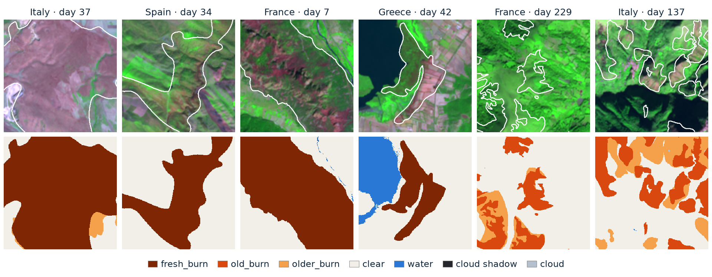

<!-- Logo row. Add the files to assets/logos/ and clear their use first (assets/logos/README.md), then remove these comment markers.
<p align="center">
  &nbsp;&nbsp;&nbsp;&nbsp;
  &nbsp;&nbsp;&nbsp;&nbsp;
  &nbsp;&nbsp;&nbsp;&nbsp;
  
</p>
-->

<h1 align="center">burn2scar</h1>

<p align="center">
  <b>A Sentinel-2 Level-1C burn-scar dataset for onboard burnt-area mapping</b><br>
  13,895 Mediterranean fires · 26,846 labelled tiles · 13 bands at 10 m · seven classes
</p>

<p align="center">
  <a href="https://doi.org/10.5281/zenodo.23986827"></a>
  <a href="https://huggingface.co/datasets/neet1797/burn2scar"></a>
  <a href="https://huggingface.co/neet1797/burn2scar-unet-r34"></a>
  <a href="LICENSE"></a>
  <a href="https://creativecommons.org/licenses/by/4.0/"></a>
</p>

<p align="center">
  
  <br>
  <sub>Tiles drawn at random among those with at least 15 % burn: false colour (B12, B8A, B04) with the burn outlined, above the mask. Contains modified Copernicus Sentinel data.</sub>
</p>

burn2scar pairs Sentinel-2 Level-1C images with pixel-level burn-scar masks for the fires of 5 to 2,000 ha that
the European Forest Fire Information System (EFFIS) mapped in Italy, Spain, southern France and Greece from
January 2020 to August 2026. We built it to train a burnt-area model that runs on board a satellite, for the
IRIDE HEO constellation. Such a model sees one top-of-atmosphere image at a time, clouds included, and has to tell
a new burn from last year's. The masks hold exactly that: burn by age, with cloud, cloud shadow and water labelled
in the same mask.

This repository holds the code that built the dataset, a baseline model, two notebooks to explore both, one example
fire, and the tools behind the data paper's validation and figures. The data themselves are on
[Zenodo](https://doi.org/10.5281/zenodo.23986827).

**Contents:** [Quickstart](#quickstart) · [The dataset](#the-dataset) · [Baseline model](#baseline-model) ·
[Notebooks](#notebooks) · [Rebuild the dataset](#rebuild-the-dataset) · [Repository layout](#repository-layout) ·
[Environment](#environment) · [Citation](#citation) · [Licence and attribution](#licence-and-attribution) ·
[Acknowledgements](#acknowledgements)

## Quickstart

```bash
git clone https://github.com/paramkaur10/burn2scar_dataset_creation.git
cd burn2scar_dataset_creation
pip install -r requirements.txt            # or: conda env create -f environment.yml

# run the baseline model on the example fire; the first run downloads its weights (98 MB)
python tools/predict.py --image examples/*_s2.tif --out-dir predictions

jupyter lab notebooks/                     # explore the data, run the model
```

## The dataset

| | |
|---|---|
| **Fires** | 13,895 EFFIS fires of 5 to 2,000 ha, January 2020 to August 2026 |
| **Where** | Italy, Spain, France south of 46° N, Greece |
| **Tiles** | 26,846 tiles of 2.56 × 2.56 km (256 × 256 pixels), centred on the fire, in the local UTM zone |
| **Scenes** | Up to two per fire: 5 to 60 days and 120 to 300 days after it; 12,951 fires have both |
| **Images** | Sentinel-2 Level-1C, all 13 bands on a 10 m grid, top-of-atmosphere reflectance × 10,000, uint16 GeoTIFF |
| **Masks** | Seven classes and no data, uint8 GeoTIFF with a colour table |
| **Splits** | Spatial (0.5° blocks), by fire year, and each country held out in turn |
| **Size, licence** | 30.7 GB; CC BY 4.0, with the Copernicus and EFFIS notices |

### Classes

| | Value | Class | Rule | Share of valid pixels |
|:-:|:-:|---|---|--:|
|  | 2 | fresh_burn | Inside an EFFIS perimeter dated 0 to 90 days before the scene | 7.19 % |
|  | 3 | old_burn | Perimeter dated over 90 and up to 365 days before the scene | 7.32 % |
|  | 7 | older_burn | Perimeter dated over 365 days before the scene; only where the pixel would otherwise be clear | 6.24 % |
|  | 0 | clear | None of the others | 77.26 % |
|  | 6 | water | NDWI above 0.05 or Scene Classification value 6; in November to February scenes, only where the fire's March to October scene doesn't show land | 1.28 % |
|  | 5 | cloud shadow | [OmniCloudMask](https://github.com/DPIRD-DMA/OmniCloudMask) | 0.19 % |
|  | 4 | cloud | OmniCloudMask, thick and thin cloud together | 0.54 % |
|  | 255 | no data | No data in the source image | |

Burn age comes from every EFFIS perimeter in the tile, not only the tile's own fire. Where classes overlap, cloud
wins over shadow, shadow over burn, fresh burn over old burn, and burn over water. `clear` is whatever is left, so it
includes bare soil, rock and sparse scrub.

### Download

**Everything** is on [Zenodo](https://doi.org/10.5281/zenodo.23986827): images zipped by country and fire year,
`masks.zip`, `index.csv`, the reviewed points, the EFFIS export the labels came from, and a README. Unzip all of it
into one folder.

**A few tiles** at a time from [Hugging Face](https://huggingface.co/datasets/neet1797/burn2scar):

```python
import pandas as pd
from huggingface_hub import hf_hub_download

repo = "neet1797/burn2scar"
index = pd.read_csv(hf_hub_download(repo, "index.csv", repo_type="dataset"))
tile = index.query("split == 'test' and frac_fresh > 0.2").iloc[0]
image = hf_hub_download(repo, tile.image_path, repo_type="dataset")   # 13-band GeoTIFF
mask = hf_hub_download(repo, tile.mask_path, repo_type="dataset")
```

`index.csv` has one row per tile: paths, fire and scene dates, place, class shares, quality flags, the Sentinel-2
products used and the splits. Use the supplied splits rather than a random one: 83 % of the fires overlap another
fire's tile, so a random split puts the same ground in training and test.

### Label quality

The labels were checked against two independent references:

- **Copernicus EMS rapid mapping.** The EFFIS outlines agree with CEMS delineations of the same fires at an F1 of
  93.3 % (117 areas from 67 activations, 2020 to 2023).
- **A visual review of 1,050 random points,** judged from the imagery alone with the mask hidden. Clear was confirmed
  at 93.9 % near a burn and 97.2 % further away, water at 92.9 %, fresh burn at 65.6 %. Old burn was visibly burned at
  24.2 % of its points: vegetation grows back within months, so old_burn records when EFFIS mapped a fire, not what
  still shows. Every point and answer is in the release.

The dataset's README on Zenodo gives the full numbers and the known limits.

## Baseline model

[`models/burn2scar-unet-r34`](models/burn2scar-unet-r34) is a U-Net with a ResNet-34 encoder trained on the main
split. It takes the 13 Level-1C bands and gives each pixel one of six classes: clear, fresh_burn, old_burn, cloud,
cloud shadow and water. On the test set it finds fresh burn with an F1 of 80.8 ± 1.2 % over five training seeds;
the released weights are the median seed. It is a baseline, there to show the labels can be learned.

```bash
python tools/predict.py --image your_s2.tif --out your_prediction.tif
```

The input is a GeoTIFF of any size with the 13 bands in the order B01 to B12, B8A after B08, as top-of-atmosphere
reflectance × 10,000 on a 10 m grid. The first run downloads the weights from
[Hugging Face](https://huggingface.co/neet1797/burn2scar-unet-r34) into the model folder and checks them. The
model card in the folder gives every score and the training settings.

## Notebooks

| Notebook | What it shows |
|---|---|
| [`01_explore_burn2scar.ipynb`](notebooks/01_explore_burn2scar.ipynb) | Where the fires are, what the masks hold, one fire seen twice, a random gallery, how each class looks in the 13 bands, and how to pick tiles for your own work |
| [`02_run_the_model.ipynb`](notebooks/02_run_the_model.ipynb) | The baseline model on random test tiles: image, mask and prediction, where it finds, misses and over-calls fresh burn, and how to run it on your own image |

GitHub shows both with their figures. They download only the tiles they show; with the Zenodo release unzipped, set
`BURN2SCAR_ROOT` to its folder to read from disk.

## Rebuild the dataset

The pipeline reads the EFFIS export, finds the scenes in the Copernicus Data Space Ecosystem through Sentinel Hub,
builds the masks and uploads each fire as it goes, so local disk use stays flat.

```bash
pip install -r environment/pipeline.txt
cp .env.example .env                         # your Sentinel Hub and Hugging Face credentials
python run_extraction.py --config config.yaml
```

`config.yaml` holds the settings of the release run. It is resumable: fires already uploaded are skipped. It needs
at least two Sentinel Hub requests per tile, about 54,000 for the release, so check your quota first. The index,
splits, label updates, validation, review, baselines and figures come after, with the tools in `tools/`, in the
order [`tools/README.md`](tools/README.md) gives.

## Repository layout

```
├── assets/               README pictures, class colours, logos
├── config.yaml           settings of the release run
├── environment/          the environments behind the release and the paper
├── examples/             one fire from the test set: two scenes and their masks
├── models/               the baseline model's card, config and scores (weights on Hugging Face)
├── notebooks/            explore the data; run the model
├── release_docs/         README, LICENSE and NOTICE shipped with the data; the Hugging Face dataset card
├── run_extraction.py     builds the dataset: EFFIS → Sentinel-2 → masks → upload
├── src/                  the pipeline's modules
└── tools/                index and splits, label updates, validation, review, baselines, figures, release
```

## Environment

| File | For |
|---|---|
| `requirements.txt`, `environment.yml` | Using the data and the model, and the notebooks |
| `environment/pipeline.txt` | Rebuilding the dataset with `run_extraction.py` |
| `environment/tools.txt` | The tools behind the index, the review, the baselines and the figures |
| `environment/paper-gpu.lock.txt` | Exact versions on the GPU server that trained the baselines and made the paper's results |
| `environment/pipeline.lock.txt` | Exact versions of the environment that built the dataset |

## Citation

If you use burn2scar, please cite the dataset:

```bibtex
@misc{thind2026burn2scar,
  author    = {Thind, Parampuneet Kaur and Cadau, Enrico and Del Prete, Roberto and
               Ricolfi, Silvia and Meoni, Gabriele and Taramelli, Andrea},
  title     = {burn2scar: a {Sentinel-2} burn-scar segmentation data set},
  version   = {3.0},
  publisher = {Zenodo},
  year      = {2026},
  doi       = {10.5281/zenodo.23986827}
}
```

A data paper describing burn2scar is in preparation. For the code, use "Cite this repository" on this page
(`CITATION.cff`).

## Licence and attribution

| Part | Licence |
|---|---|
| Code in this repository | Apache 2.0 ([`LICENSE`](LICENSE)) |
| Baseline model weights | Apache 2.0 |
| The dataset, and the example fire in `examples/` | CC BY 4.0, with the Copernicus Sentinel data terms and the EFFIS licence; see the `LICENSE.txt` and `NOTICE.txt` that come with it |

When you use the data, keep this credit:

```
Contains modified Copernicus Sentinel data 2020-2026.
Contains modified Copernicus Service information 2020-2026.
Burn labels adapted from EFFIS, Copernicus Emergency Management Service,
© European Union, 1995-2026, CC BY 4.0
(https://creativecommons.org/licenses/by/4.0/). Changes: perimeters rasterised
to a 10 m grid, split into fresh, old and older burn classes by date, and
merged with cloud, cloud shadow and water classes.
```

## Acknowledgements

burn2scar is built on open European data. The images are Copernicus Sentinel-2 data, from the Copernicus Data Space
Ecosystem; Sentinel-2 is a mission of Copernicus, the European Union's Earth observation programme, developed and
operated by the European Space Agency. The fire perimeters come from EFFIS, part of the Copernicus Emergency
Management Service, run by the European Commission's Joint Research Centre. Copernicus EMS rapid-mapping
delineations, through [wildfires-cems](https://huggingface.co/datasets/links-ads/wildfires-cems), were used to check
the labels. Cloud and cloud shadow come from [OmniCloudMask](https://github.com/DPIRD-DMA/OmniCloudMask).

## Authors

Parampuneet Kaur Thind<sup>1,2,3</sup>, Enrico Cadau<sup>1</sup>, Roberto Del Prete<sup>1</sup>,
Silvia Ricolfi<sup>1,2</sup>, Gabriele Meoni<sup>1</sup>, Andrea Taramelli<sup>1,3,4</sup>

<sup>1</sup> European Space Agency (ESA), ESRIN · <sup>2</sup> Sapienza University of Rome ·
<sup>3</sup> University School for Advanced Studies IUSS Pavia ·
<sup>4</sup> Italian Institute for Environmental Protection and Research (ISPRA)

Questions and problems: please open an [issue](https://github.com/paramkaur10/burn2scar_dataset_creation/issues).
